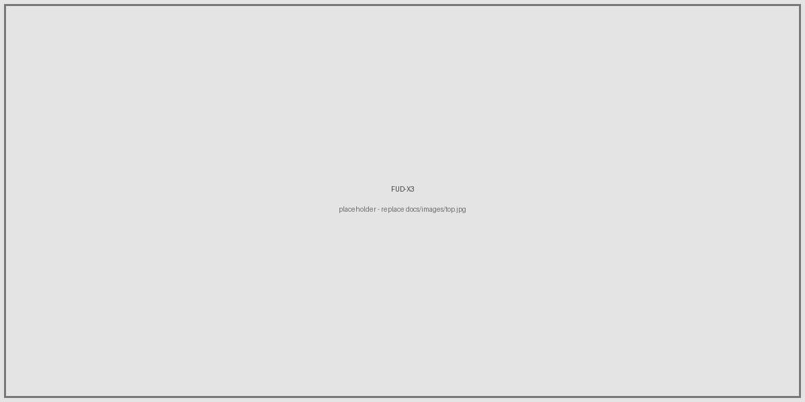
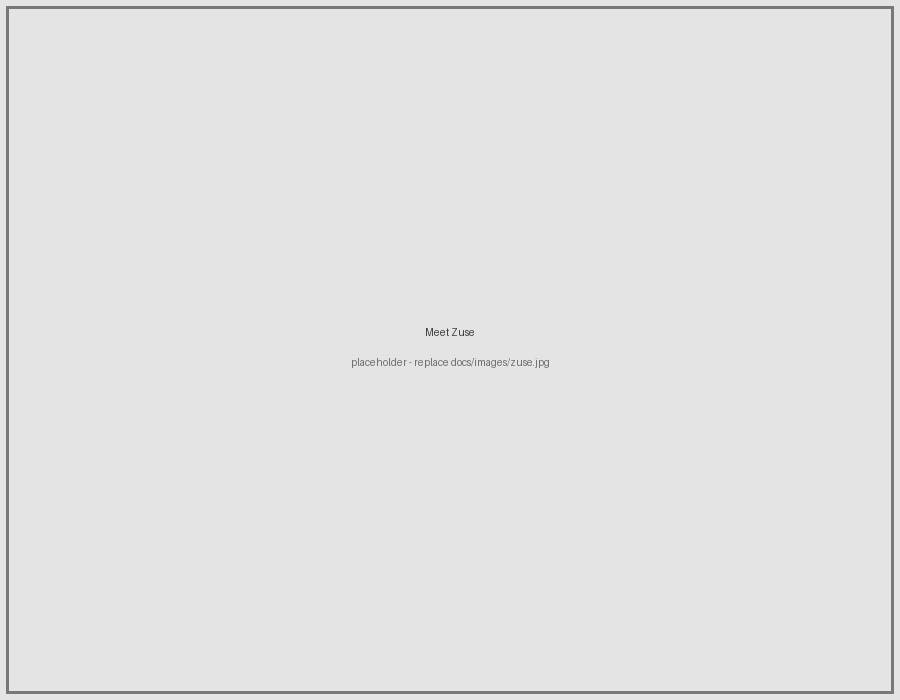
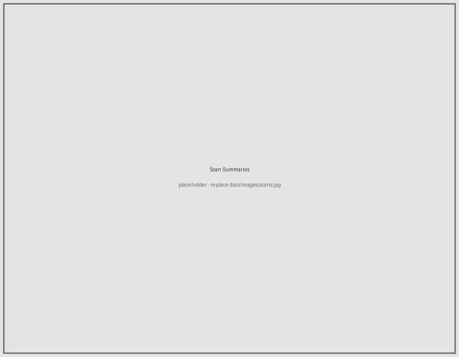
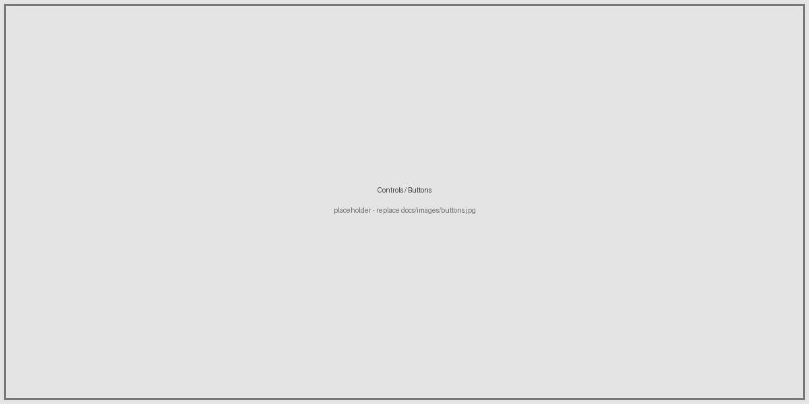
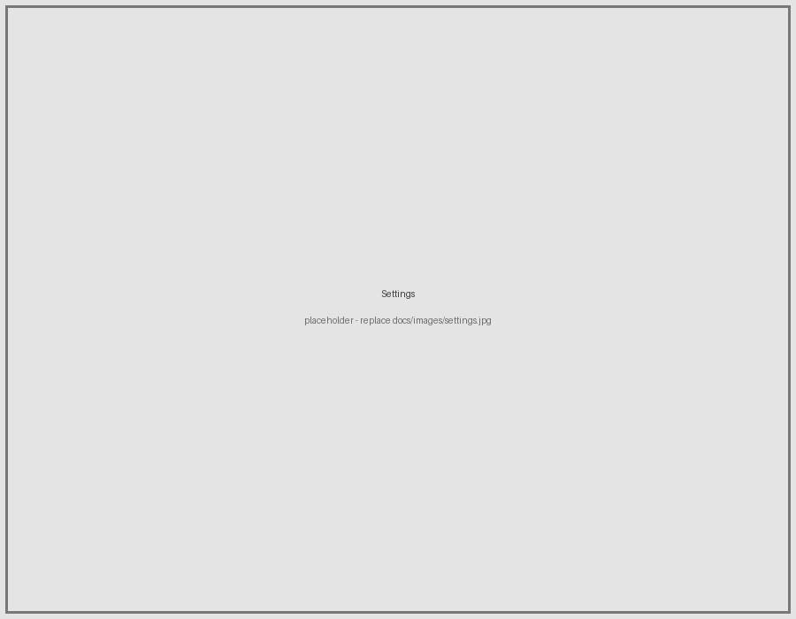

# FUD-X3



FUD-X3 is passive counter-surveillance firmware for the XTEINK X3, a small
ESP32-C3 e-ink device. It is a port of [FUD-Firmware](https://github.com/thoughtfix/FUD-Firmware)
that trades the e-reader for a full-time radio watcher. It listens for the
Bluetooth and Wi-Fi signatures of trackers, hidden cameras, drones, hacker
tools, and active attacks, shows them at a glance, and logs them to an SD card.

FUD-X3 is receive-only. It never transmits, never joins a network, and never
runs an attack. It watches, it reports, and it keeps a log. That is the whole
job.

## Meet Zuse



Zuse is the face of the device. The home screen is Zuse plus a plain count of
what is around you. When something worth noting shows up, Zuse reacts (wary for
a tracker or camera, angry for a hacker tool or an attack) and the matching
threat icon appears beside him. Acknowledge an alert and Zuse settles back down
until something new arrives. When the battery gets low, Zuse lets you know.

## What Zuse looks for



Detections are grouped into categories you can drill into for per-device detail
(name, address, signal, and how long it has been hanging around):

- Trackers: AirTag and Find My beacons (collapsed into a single count, since
  they rotate their address), plus fixed-identity tags like Tile, SmartTag, and
  Chipolo.
- Cameras: known wireless camera signatures.
- Drones: ASTM F3411 / Open Drone ID Remote ID broadcasts.
- Hacker Devices: Flipper Zero, Pwnagotchi, card-skimmer modules, and similar.
- Attacks: Wi-Fi deauthentication floods, BLE pairing-popup spam, and evil-twin
  access points.
- Open Wi-Fi: open networks with no threat signature, logged for context (not an
  alert).

There is also a live Wi-Fi Networks view that lists what the last scan saw,
sorted by signal strength, with open networks tagged.

Because the ESP32-C3 has a single 2.4 GHz radio, Wi-Fi and Bluetooth are
time-sliced: a Bluetooth window, then a Wi-Fi window (which also runs the
promiscuous pass that detects deauth floods), and back again.

## Controls



Four buttons sit on the front (A, B, C, D) with two more on the sides
(Previous and Next), and a power button on the top right. Every screen shows a
title bar with the current time and battery level across the top, and a hint bar
across the bottom so you always know what the active buttons do.

- Home screen: A or Left opens Settings, D or Right opens Scan Summaries, B
  acknowledges an active alert.
- Lists: A moves up, B moves down, C goes back, D opens the highlighted item.
  The side buttons step between sibling items.
- Power button: a short press shows the sleep screen and deep-sleeps (press
  again to wake). Holding A from anywhere returns to the Zuse home screen.

## Settings



- Set Clock: set the real-time clock by hand (used for dated log files).
- Logging: turn SD logging on or off.
- Auto Sleep: sleep after a period of no input (Never, 5, 15, or 30 minutes).
  The default is Never, so the device stays awake collecting data until the
  battery runs out.
- Baseline: mark everything currently seen as known, so only new devices stir
  Zuse.
- Ignore List: drop your own known devices and networks from alerts.
- SD Card: card status, log file count, and size.
- Delete Logs: remove log files, scoped to Today, This Week, or All.
- Battery Test: a drain test. Unplug USB to start a stopwatch that records
  battery percentage, voltage, and current to the SD card every minute until the
  device dies. The e-ink display holds the final elapsed time after it powers
  off.

## Logging

With a card inserted, detections are written to a dated CSV file per day
(for example `/.fudx3/20261018.csv`). The SD card is removable and hot-swap
safe: the firmware boots and runs with no card, survives removal without
hanging, and resumes logging when a card is inserted. Analyze the CSV files on a
computer. There is no on-device analytics and no GPS or WiGLE upload.

## Build and flash

This device was bought direct and is free to flash. If you are not sure whether
your unit is USB-locked, check with the community before flashing, and always
back up first.

Requirements: [PlatformIO](https://platformio.org/) and Python 3. The build
uses the pioarduino Espressif platform, which needs a few Python packages; a
`requirements.txt` is included.

1. Clone with the HAL submodule:

   ```
   git clone --recurse-submodules https://github.com/thoughtfix/FUD-X3.git
   cd FUD-X3
   ```

   (If you already cloned without it: `git submodule update --init --recursive`.)

2. Create a virtualenv and install the build dependencies:

   ```
   python3 -m venv .venv
   .venv/bin/pip install -U platformio
   .venv/bin/pip install -r requirements.txt
   ```

3. Build:

   ```
   .venv/bin/pio run -e x3
   ```

4. Back up the stock firmware before writing anything (replace the port with
   yours):

   ```
   .venv/bin/esptool --chip esp32c3 --port /dev/cu.usbmodem1101 \
     read_flash 0 0x1000000 backup-stock-16mb.bin
   ```

5. Flash only the application slot. Do not use `pio run -t upload`, which would
   overwrite the stock bootloader and partition table. Write the app image to
   `0x10000` with esptool:

   ```
   .venv/bin/esptool --chip esp32c3 --port /dev/cu.usbmodem1101 \
     write_flash 0x10000 .pio/build/x3/firmware.bin
   ```

To return to stock, write your backup back with
`write_flash 0x0 backup-stock-16mb.bin`.

## Hardware notes

- MCU: ESP32-C3 (single core RISC-V, no PSRAM).
- Display: 792x528 one-bit e-ink, used in portrait (528 wide by 792 tall).
- Clock: DS3231 real-time clock on I2C.
- Battery: TI BQ27220 fuel gauge on I2C, so percentage, voltage, and current are
  readable in firmware.
- Storage: microSD card slot, sharing the display SPI bus.

## Attributions and thanks

FUD-X3 is built on the work of others, with credit.

- [FUD-Firmware](https://github.com/thoughtfix/FUD-Firmware), the parent project,
  including Zuse and the signature set.
- The [community-sdk](https://github.com/crosspoint-reader/community-sdk)
  hardware abstraction layer (display, input, SD, battery), used as a library.
- The [crosspoint-reader](https://github.com/crosspoint-reader/crosspoint-reader)
  project and FreeInk SDK, whose HAL made clear that the X3 reads its battery
  through a TI BQ27220 fuel gauge on I2C. The register commands are from the
  BQ27220 datasheet and the driver here is written fresh.
- [NimBLE-Arduino](https://github.com/h2zero/NimBLE-Arduino) by h2zero and the
  [Adafruit GFX library](https://github.com/adafruit/Adafruit-GFX-Library).

Signature data traces back to public registries: the IEEE OUI registry, the
Bluetooth SIG assigned numbers, ASTM F3411 / Open Drone ID, and the FCC ID
database.

If FUD-X3 is not quite what you are after:

- Got an X4? Look at [biscuit](https://github.com/yattsu/biscuit), a broader
  multi-tool firmware for the larger Xteink X4.
- Need to keep yours a reader? Look at
  [Radio Ink](https://github.com/dagnazty/Radio-Ink), which keeps the full
  CrossPoint e-reader and adds a Wi-Fi / BLE toolkit (X3 and X4).

## Responsible use

FUD-X3 is receive-only and never transmits or attacks, but it is still a radio
monitoring tool. Use it lawfully and respectfully. See
[DISCLAIMERS.md](DISCLAIMERS.md).

## AI disclosure

See [AI_DISCLOSURE.md](AI_DISCLOSURE.md).

## License

FUD-X3 is released under the [GNU General Public License v3.0](LICENSE), the same
license as FUD-Firmware. Use it, study it, change it, and share it, but keep
derivatives open under the same terms.
